# PromptShield — Private AI Prompt Sanitizer

> **Share the prompt. Not the sensitive bits.**

PromptShield helps you inspect AI prompts before you send them. It flags potential
personal data, financial identifiers, secrets, internal/confidential content, and
prompt-risk indicators — then lets you redact, pseudonymize, or replace exactly what
you choose, review a before/after diff, and copy or download a safer version.

**Everything runs in your browser.** There is no backend, no account system, no
analytics, and no AI service: prompt text is analyzed by a Web Worker on your device
and is never transmitted by the application. See [docs/PRIVACY.md](docs/PRIVACY.md)
for the precise data-flow contract, its verification method, and its limits.

> PromptShield scans text in your browser and suggests potential sensitive information
> and risk indicators. Detection is heuristic: it can miss sensitive content and flag
> harmless text. Review every change before sharing. PromptShield does not guarantee
> that a prompt is anonymous, secure, or resistant to prompt injection.

**Live app:** [https://singhtanishq.github.io/PromptShield/](https://singhtanishq.github.io/PromptShield/)

## Screenshots

Every screenshot below is a genuine capture of the running application using only
synthetic data (RFC 2606 reserved domains, documented example tokens, fictional
people and companies). Nothing real was ever entered.

### The sanitizer workspace

The landing view: paste or type a prompt on the left, choose redactions yourself,
and copy the safer version from the right. Nothing is redacted until you act.

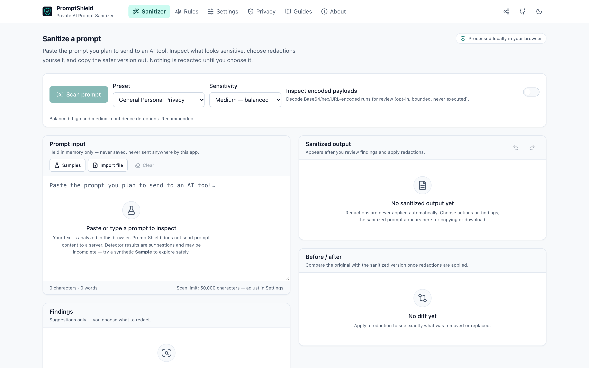

### Synthetic sample prompts

Five built-in samples — developer bug report, support escalation, confidential brief,
data analysis, meeting summary — let you try the tool without exposing real content.
Each exercises different detectors and includes benign lookalikes.

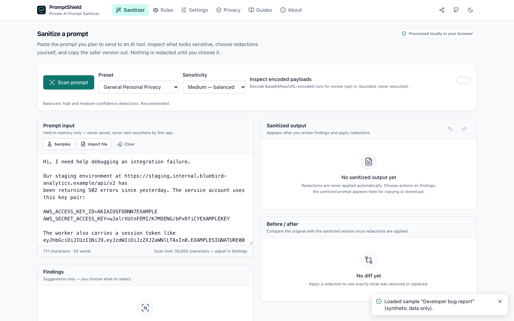

### Detection findings

Scan results grouped by category with a severity summary. Every finding pairs a
severity badge (how consequential) with a confidence badge (how certain) — never
color alone — and shows a masked preview, its location, why it matched, and what to
do about it. Raw values never appear in the findings list.

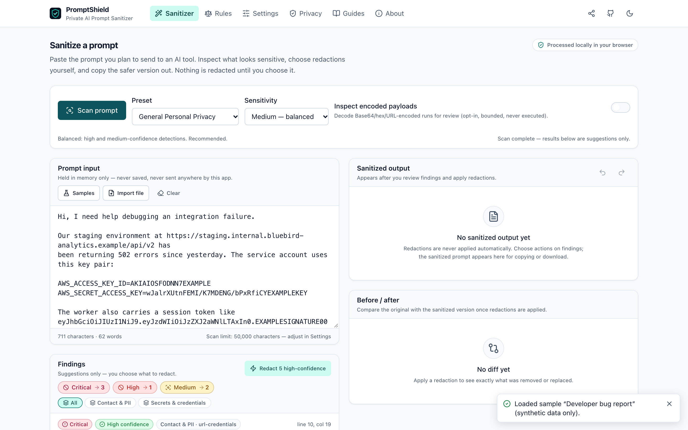

### Choosing a redaction action

Each finding opens an action menu: mask with a category placeholder, pseudonymize,
typed context placeholders, a custom replacement with preview, a partial mask that
keeps the last four digits where appropriate, or full removal. Prompt-risk findings
offer "quote as untrusted data" instead of silent rewrites.

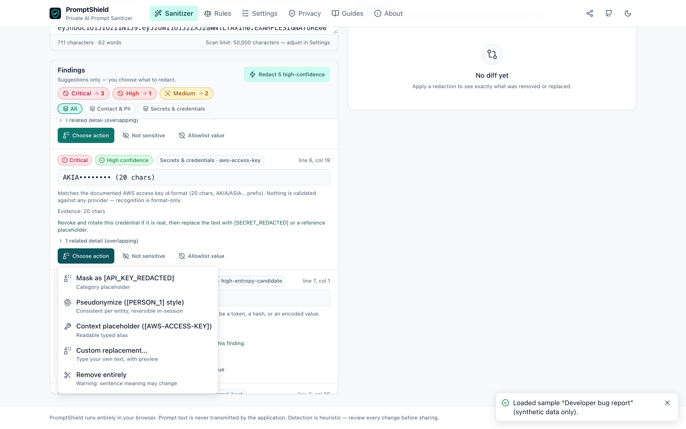

### Sanitized output and before/after diff

Applied decisions produce a sanitized output with copy and download actions. The
diff highlights exactly what was removed or replaced, side by side on desktop and
inline on mobile. The original stays in the editor until you clear it.

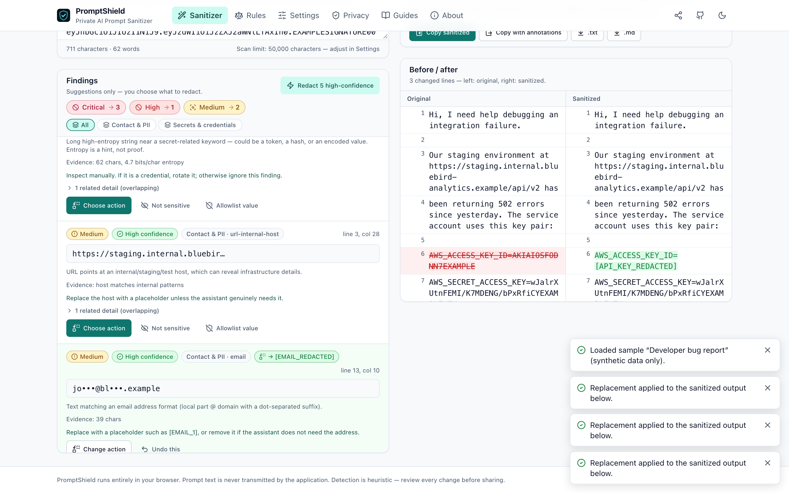

### Pseudonymization with a session-only map

Repeated entities map to the same placeholder ([PERSON_1]) for the whole session. A
visible indicator shows when a reversible map exists in memory, with explicit
"Re-identify" and "Forget mapping" controls. The reverse map is never persisted.

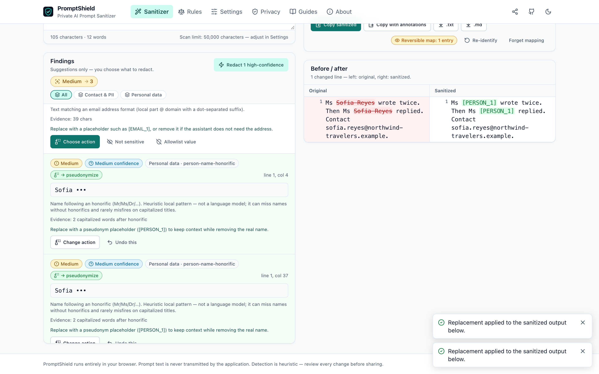

### Custom rules

Teach PromptShield your organization's patterns — codenames, customer identifiers,
internal tooling names — with your own severity, confidence, and replacement
placeholder. Rules run in the scan worker with length caps and a time budget, must
pass their test cases before saving, and export/import as JSON definitions.

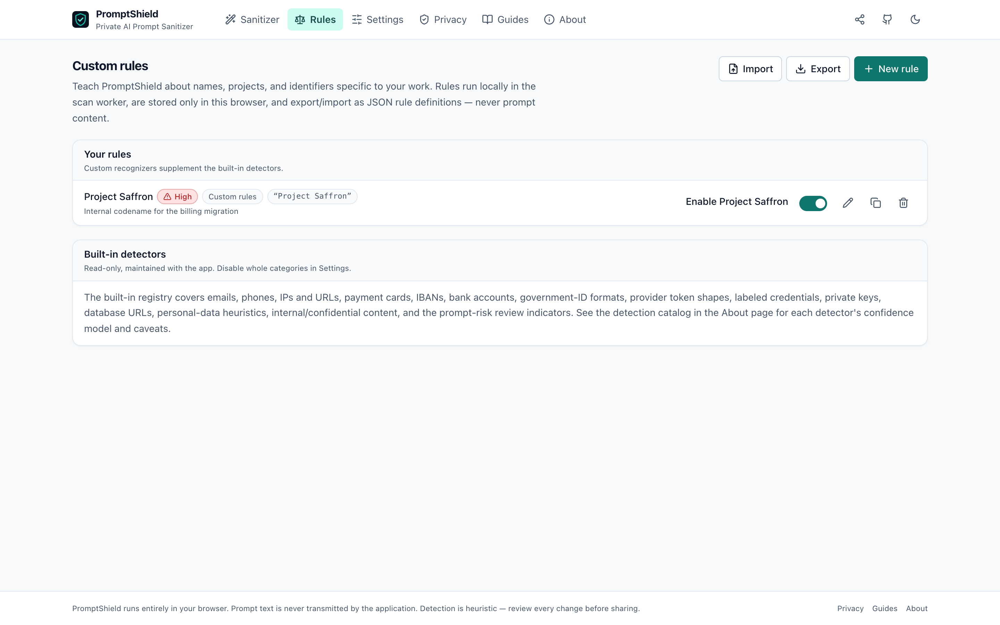

### Presets and detection settings

Presets (General Privacy, Developer/Secrets, Work/Confidential, Financial, Minimal)
toggle detector categories and sensitivity in one step. Every category can also be
tuned individually; disabled categories are never scanned. Preferences persist
locally and contain no prompt content.

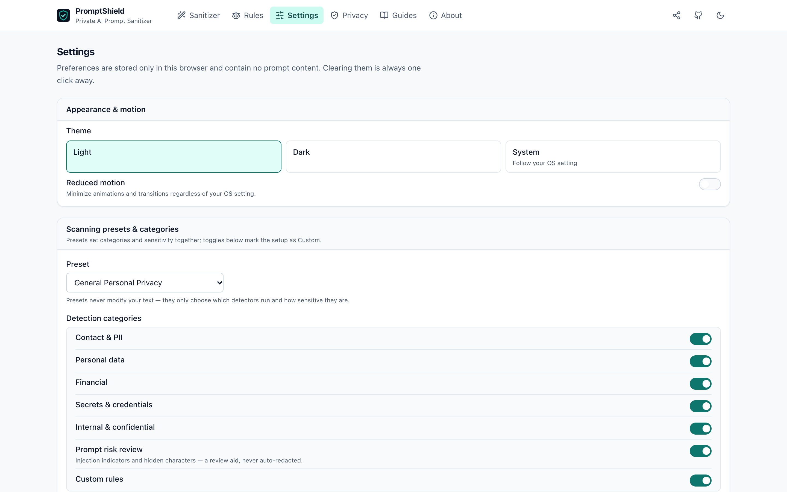

### Privacy center

The exact data-flow contract: what is processed, what is stored where, what is never
transmitted, and the honest caveats (host access logs, browser extensions,
clipboards). One-click controls clear the session and local settings separately.

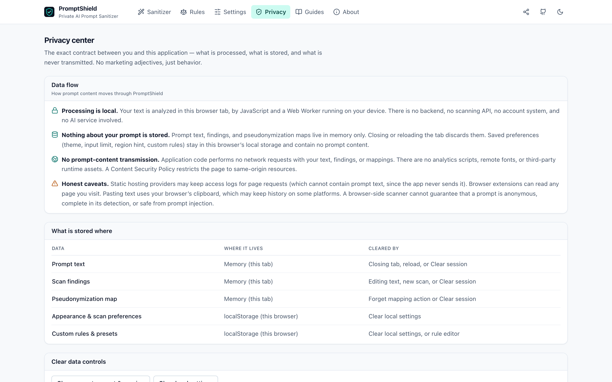

### Mobile layout

The workspace stacks on narrow screens with a hamburger navigation, and the diff
renders inline. The same scan/redact/copy flow works end to end on a phone.

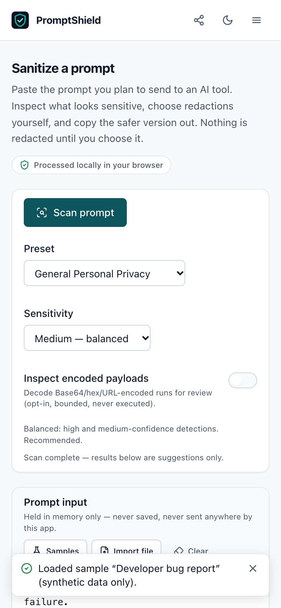

### Light theme

A restrained security-utility aesthetic: deep slate surfaces, a single teal accent,
icon-plus-text status labels, and WCAG 2.2 AA contrast targets.

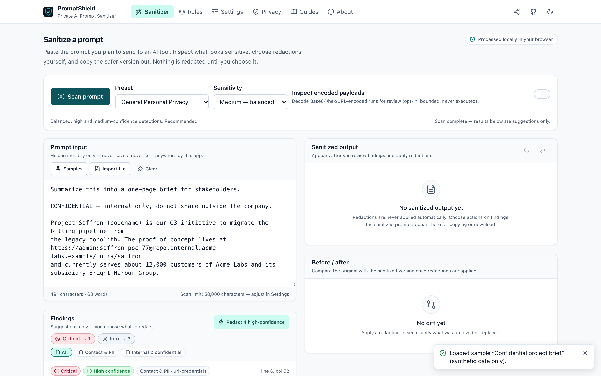

### Dark theme

The same system on a deep ink foundation — designed, not inverted.

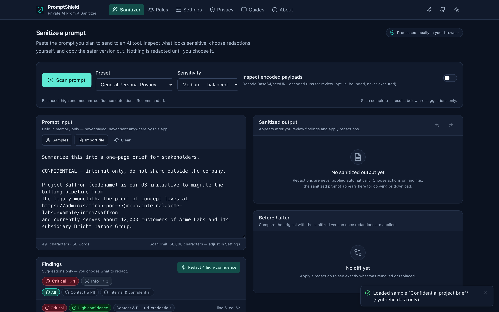

## Features

- **Local detection engine** — 13 detector families covering emails, phones (with
  region hints), validated IPv4/IPv6, URLs with embedded credentials or tracking
  parameters, Luhn-validated cards, mod-97 IBANs, bank-account candidates,
  government-ID formats (heuristic), documented provider token shapes, JWTs,
  bearer/basic tokens, labeled passwords, private keys, database URLs with
  credentials, credential env-vars, session cookies, recovery codes, conservative
  name/address/DOB heuristics, internal hostnames and file paths, confidential
  labels, and a separate prompt-risk review (injection phrasing, hidden Unicode,
  opt-in bounded encoded-payload inspection).
- **Explicit redaction workflow** — scanning never changes text; mask, pseudonymize,
  custom replace, partial mask, remove, and context placeholders; bulk redaction of
  high-confidence findings with per-finding undo; 50-step undo/redo.
- **Session-only pseudonymization** — consistent per-entity placeholders, visible
  reversible-map indicator, warning-gated re-identification, one-click forget.
- **Custom rules and presets** — user patterns validated against ReDoS, tested in
  the worker, persisted locally, exported/imported as JSON (rules only).
- **Copy/download with privacy by default** — sanitized text only; an explicit
  "copy with annotations" adds category counts, never values.
- **Accessibility** — keyboard-only operation (skip link, Ctrl/Cmd+Enter scan),
  focus-trapped dialogs, ARIA menu pattern, screen-reader status announcements,
  reduced-motion support, axe-verified (WCAG 2.0/2.1 A+AA) in both themes.
- **Privacy verification** — static audit script plus Playwright canary tests
  asserting a synthetic marker prompt never reaches network traffic, console
  output, storage, or URLs across scan/redact/copy/download/navigation flows.

## Architecture

Vite + React 18 + TypeScript (strict) + Tailwind CSS. Detection runs in a Web
Worker through a versioned typed protocol with progress, cooperative cancellation,
and a hard-timeout terminate-and-respawn backstop. Overlapping detections resolve
deterministically (severity → confidence → span length → position) with shadowed
findings kept as sub-details. No router dependency (hash routing), no Radix, no
remote fonts — the only runtime dependencies are React and lucide-react icons.
Details in [docs/ARCHITECTURE.md](docs/ARCHITECTURE.md).

## Development

```bash
pnpm install        # install dependencies
pnpm dev            # start the dev server
pnpm test           # unit & integration tests (153)
pnpm test:e2e       # Playwright E2E against the production build (24)
pnpm lint           # eslint
pnpm typecheck      # tsc project build
pnpm build          # production build (dist/)
pnpm preview        # serve the production build locally
pnpm audit:privacy  # static privacy audit of source & build output
pnpm screenshots    # capture docs/screenshots from the running app
pnpm validate:readme# verify every screenshot is embedded in the README
```

CI runs format check, lint, typecheck, unit tests, production build, the privacy
audit, and the Playwright E2E suite on every push and pull request; the site deploys
to GitHub Pages from `main`. See [.github/workflows/ci.yml](.github/workflows/ci.yml)
and [.github/workflows/deploy.yml](.github/workflows/deploy.yml).

## Documentation

- [Privacy](docs/PRIVACY.md) — what is processed, stored, and never transmitted
- [Architecture](docs/ARCHITECTURE.md) — components, worker protocol, storage model
- [Detection catalog](docs/DETECTION-CATALOG.md) — every detector, confidence model, caveats
- [Security](docs/SECURITY.md) — threat model, CSP, scope, limitations
- [Testing](docs/TESTING.md) — test matrix, privacy audit, canary procedure
- [User guide](docs/USER-GUIDE.md) — practical walkthrough with screenshots
- [Changelog](CHANGELOG.md)

## Limitations

Detection is heuristic. It misses sensitive content (false negatives), flags
harmless text (false positives), and deliberately does not attempt full name
recognition without a language model. Provider token shapes are recognized only
where stable and documented. Prompt-risk indicators are keyword rules — evadable
and noisy — and a browser-side scanner cannot guarantee anything about how an AI
system behaves. Pseudonymization reduces direct exposure but may not fully
anonymize context. PromptShield is not a DLP product and makes no compliance
claims. See [docs/SECURITY.md](docs/SECURITY.md) for the full scope.

## Contributing

Issues and pull requests are welcome. Keep custom-rule examples synthetic, never
paste real prompt content into bug reports, and run the full gate suite
(`pnpm lint && pnpm typecheck && pnpm test && pnpm build && pnpm audit:privacy`)
before submitting.

## License

[MIT](LICENSE). PromptShield is an independent project, not affiliated with or
endorsed by any AI provider; provider names appear only to describe recognizable
token formats.
