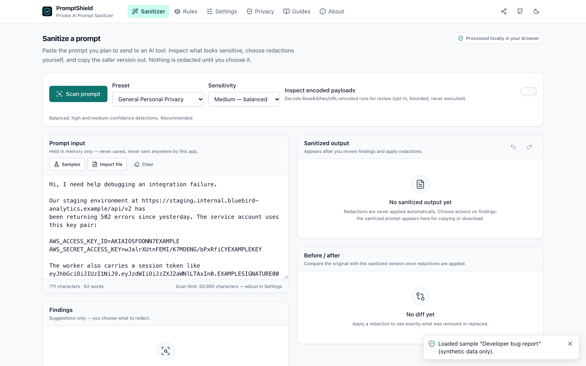
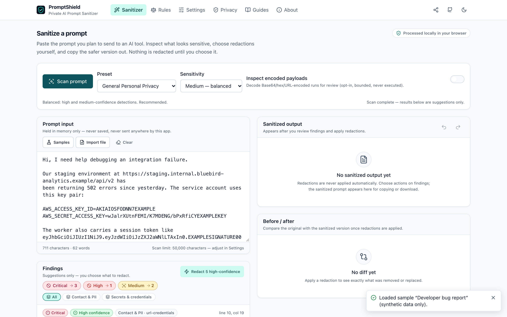
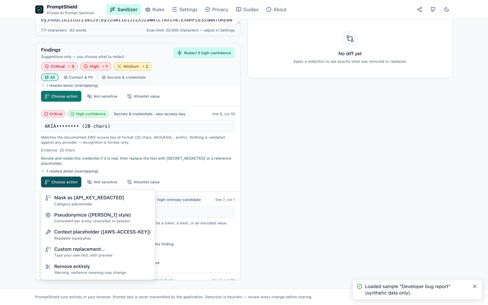
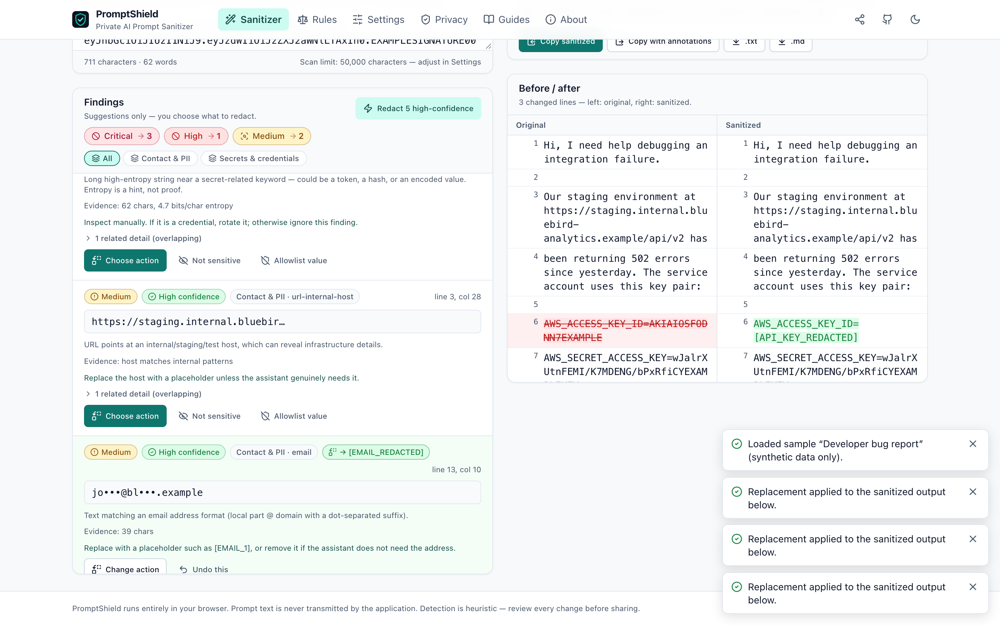
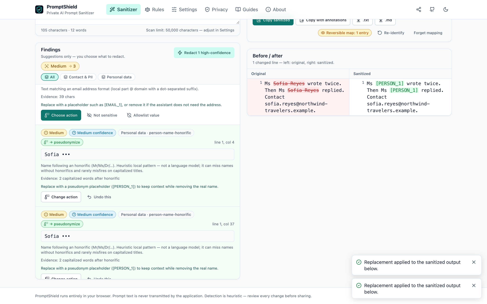
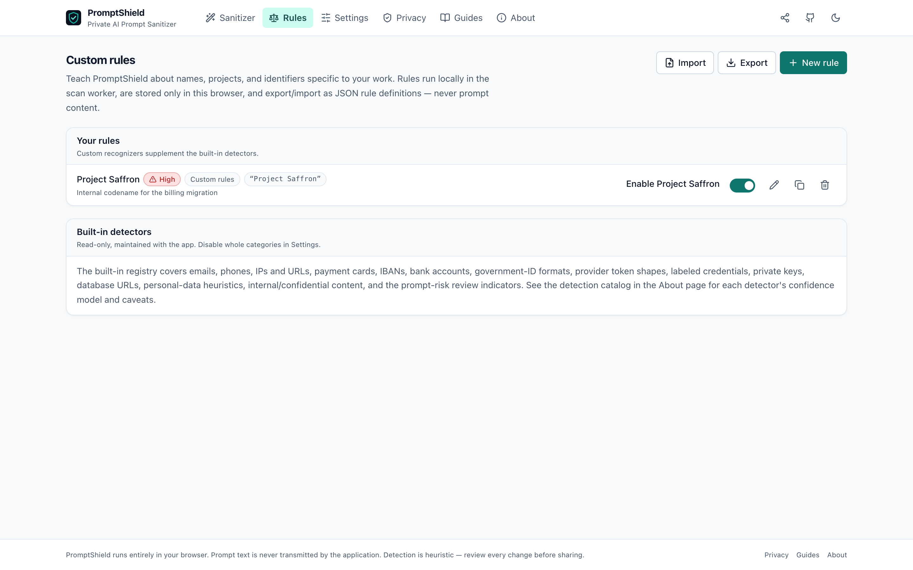
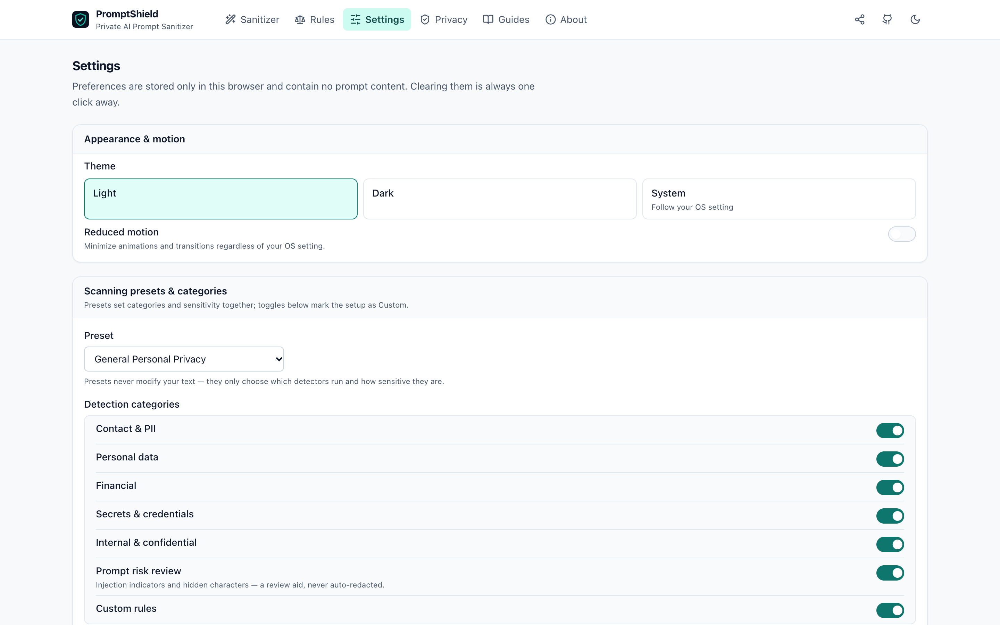
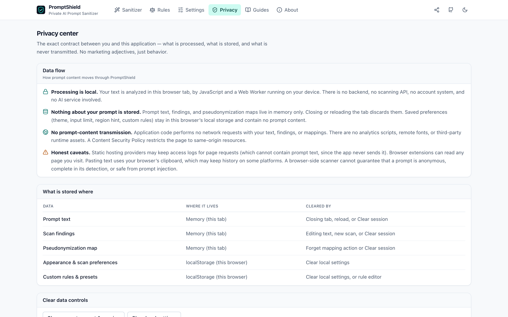
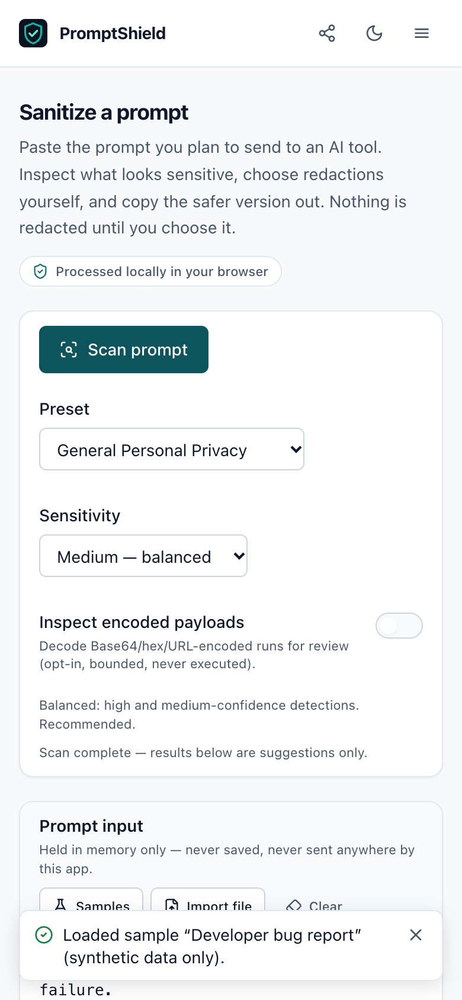

# User guide

A practical walkthrough of PromptShield — from an empty workspace to a sanitized,
copy-ready prompt. Screenshots are genuine captures of the app; the data is
synthetic.

## 1. Get text in

Paste or type into the **Prompt input** panel, or use one of the alternatives:

- **Samples** — five synthetic examples (developer bug report, support
  escalation, confidential brief, data analysis, meeting summary). They contain
  only fictional values and are the safest way to explore.
- **Import file** — read a local `.txt` or `.md` file (≤25 MB). Files are read by
  your browser only; nothing is uploaded. Importing replaces the current prompt
  after a confirmation.

Your text lives in memory for this tab session only. The counter under the editor
shows characters and words against the scan limit (adjustable in Settings).

## 2. Scan

Press **Scan prompt** (or `Ctrl/Cmd+Enter`). Scanning runs in a Web Worker; a
progress indicator shows stages and you can cancel at any time. Scanning never
changes your text.

Before scanning, optionally adjust:

- **Preset** — General Privacy, Developer/Secrets, Work/Confidential, Financial,
  or Minimal. Presets only choose which detectors run and how sensitive they are.
- **Sensitivity** — low (fewest flags), medium (balanced), high (most coverage,
  more false positives).
- **Inspect encoded payloads** — opt-in bounded inspection of Base64/hex/URL
  encoded runs; the decoded preview is shown as inert text and never executed.

## 3. Review findings

Findings appear grouped with a severity summary (critical/high/medium/low/info).
Each finding shows:

- a **severity badge** (how consequential if real) and a **confidence badge**
  (how sure the heuristic is) — independent concepts, always with icon and text;
- a **masked preview** — enough structure to identify the match, never the value;
- its **location** (line/column) and **why it matched**;
- **evidence** where available (e.g. "passes Luhn checksum", "U+200B");
- a **remediation suggestion**.

Filter by category, expand **related details** to see overlapping sub-matches
(e.g. the credentials inside a database URL), or mark a finding **Not sensitive**
to hide it for this session. **Allowlist value** excludes one exact value from
future scans — the allowlist lives in memory only, shows masked previews, and
offers one-click re-enable.

## 4. Choose redactions

Open a finding's **Choose action** menu:

| Action                  | What it does                                                                       |
| ----------------------- | ---------------------------------------------------------------------------------- |
| Mask                    | Replaces with a category placeholder (`[EMAIL_REDACTED]`, `[API_KEY_REDACTED]`, …) |
| Pseudonymize            | `[PERSON_1]`-style placeholder, consistent per entity for the session              |
| Context placeholder     | Readable typed alias (`[CUSTOMER_NAME]`, `[MAILING_ADDRESS]`)                      |
| Custom replacement      | Your own text, with a live preview                                                 |
| Keep last 4 digits      | Partial mask for cards/IDs/phones where a suffix is useful                         |
| Remove entirely         | Deletes the span (sentence meaning may change)                                     |
| Quote as untrusted data | (Prompt-risk findings) wraps the span in `<untrusted_content>` tags                |

Nothing is applied until you choose. Applied findings show a green chip with the
resolved replacement; **Undo this** reverses one finding, the output panel's
undo/redo buttons step through the whole history. **Redact N high-confidence**
applies masks to all high-confidence non-risk findings at once (prompt-risk
findings are never auto-redacted).

## 5. Compare and export

The **Sanitized output** panel shows the result of your choices; the
**Before / after** diff highlights every removal and replacement (side-by-side on
desktop, inline on mobile). The original text stays in the editor until you clear
it.

- **Copy sanitized** — sanitized text only. If the clipboard is unavailable, the
  output is selected for manual copying.
- **Copy with annotations** — adds a header listing replacement categories and
  counts (never values).
- **.txt / .md** — downloads the sanitized text.

## 6. Pseudonymization lifecycle

After a pseudonymize action, a **Reversible map** chip shows how many entries
exist. **Re-identify** (confirmation required) restores original values into a
clearly labeled view; **Forget mapping** destroys the reverse map irreversibly.
The map is memory-only: it is never saved, exported, or synced, and it resets
when the text changes.

## 7. Custom rules

On the **Rules** page, create recognizers for your organization's vocabulary:

- literal text or a regular expression (≤200 chars, `i`/`m`/`s`/`u` flags);
- category, severity, confidence, and replacement placeholder;
- context keywords that must appear nearby;
- test cases that must pass before the rule can be saved (they run in the scan
  worker — a pathological regex is rejected, never hangs the page).

Rules persist in this browser, can be duplicated, enabled/disabled, deleted, and
exported/imported as JSON **rule definitions** — never prompt content.

## 8. Settings, presets, and privacy controls

**Settings** holds theme (light/dark/system), reduced motion, the scan limit,
region hint, preset selection, and per-category toggles (disabled categories are
never scanned). Preferences persist locally and contain no prompt data.

**Export settings & rules** produces a versioned JSON of preferences and rule
definitions; **Import** validates and previews everything before applying.

**Data controls**:

- _Clear current prompt & session_ — wipes in-memory state;
- _Clear local settings_ — resets saved preferences.

## 9. Privacy center

The [Privacy page](PRIVACY.md) (in-app too) documents exactly what is processed,
stored, and never transmitted — plus the honest caveats: host access logs, browser
extensions, and clipboard history are outside this application's control. The
required disclaimer is quoted there in full.

## 10. Keyboard and mobile

- `Ctrl/Cmd+Enter` — scan from anywhere.
- `Tab` — skip link, then every control in order; menus and dialogs are fully
  keyboard-operable (`Esc` closes, arrows navigate menus).
- On narrow screens the workspace stacks, navigation moves behind the hamburger
  button, and the diff renders inline.

## Tips

- Start with **Medium** sensitivity; raise it if a scan finds too little, lower
  it if flags feel noisy.
- Add custom rules for codenames and customer names — generic heuristics
  deliberately do not attempt full name recognition.
- Read the **About** page for each detector's confidence model and limitations;
  read **Privacy** before trusting any local-only claim.
- Review every change: PromptShield is a suggestion engine with a undo history,
  not an authority.
